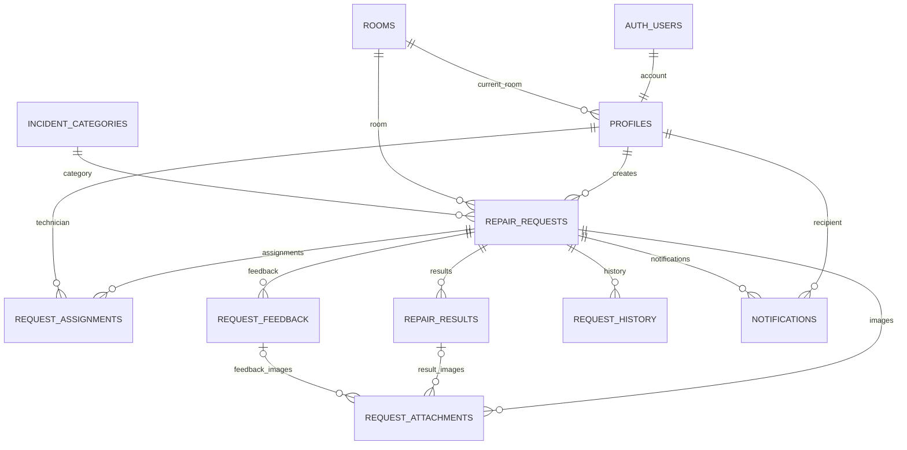

# Thiết kế database DormFix đã chốt

File `001_schema.sql` tạo 10 bảng nghiệp vụ trong một project Supabase mới, enum trạng thái, mã yêu cầu tự tăng, khóa ngoại, index và phân quyền đọc ban đầu. Đây là migration nền tảng, chưa phải backend hoàn chỉnh. Đã chạy thành công trên project DormFix ngày 12/10/2026; kết quả xác minh tại `DEPLOYMENT.md`.

Đọc công việc Kỹ thuật viên DF-020/DF-022 được bổ sung trong `004_technician_jobs.sql`, đã áp dụng ngày 15/10/2026. Hai RPC chỉ cho Kỹ thuật viên active/đã đổi mật khẩu đọc công việc hiện được giao; policy Storage cho phép tải ảnh private theo `can_read_request`. Hợp đồng tại `../docs/technician-jobs-contract.md`, test rollback tại `tests/004_technician_jobs.sql`. Các hàm ghi nghiệp vụ và quyền upload ảnh vẫn chưa có. Không chạy lại các migration đã áp dụng.

DF-028/029/030 thêm RPC đọc danh sách tài khoản Admin trong `009_admin_account_list.sql`. Migration này cần triển khai một lần trên project Supabase; không chạy lại sau khi đã áp dụng. Test phân quyền, tìm kiếm và phân trang rollback tại `tests/009_admin_account_list.sql`.

DF-043/044 thêm các RPC Admin chỉ đọc danh sách, bộ lọc và chi tiết yêu cầu trong `010_admin_request_reads.sql`. Migration chỉ thêm function trên schema hiện có, cần triển khai một lần sau khi được duyệt; không chạy lại sau khi đã áp dụng. Test rollback cho quyền Admin, bộ lọc kết hợp, khoảng ngày và dữ liệu chi tiết nằm ở `tests/010_admin_request_reads.sql`.

DF-027 thêm lịch sử từng lần phân công và thông báo trong ứng dụng Kỹ thuật viên trong `013_technician_tracking.sql`, áp dụng một lần sau 012. Người đã chuyển giao chỉ nhận snapshot tóm tắt; thao tác đánh dấu đọc chỉ dành cho chính người nhận. Trigger tạo thông báo phân công/chuyển giao/hủy/sửa lại/hoàn tất cùng transaction nguồn, không backfill dữ liệu cũ hoặc gửi thông báo đẩy. Hợp đồng tại `../docs/technician-tracking-contract.md`, script rollback tại `tests/013_technician_tracking.sql`. File migration trong Git chưa xác nhận việc triển khai lên database dùng chung.

DF-017 thêm hai RPC đánh dấu đọc thông báo Sinh viên trong `014_student_notification_reads.sql`, áp dụng một lần sau 013. Chỉ Sinh viên active/đã đổi mật khẩu được sửa `read_at` của thông báo chính chủ bằng thời gian server; giữ nguyên thời gian đã đọc và không cấp quyền ghi bảng trực tiếp. Hợp đồng tại `../docs/student-notifications-contract.md`, regression rollback tại `tests/014_student_notification_reads.sql`. Migration 014 đã triển khai ngày 03/11/2026, ghi nhận tại `DEPLOYMENT.md`; ứng dụng Sinh viên vẫn dùng mock cho cả yêu cầu và thông báo.

DF-031 thêm RPC Admin tạo tài khoản Sinh viên và gắn phòng trong `015_admin_create_student.sql`. Migration bổ sung RPC `admin_create_student(...)` đồng bộ Auth user/profile, mật khẩu tạm bắt buộc đổi lần đầu, `admin_get_active_rooms()` và trigger chống sửa đổi mã/email. Test rollback tại `tests/015_admin_create_student.sql`.

DF-032 thêm RPC Admin tạo tài khoản Kỹ thuật viên trong `016_admin_create_technician.sql`, áp dụng sau 015. RPC chỉ cho Admin active gọi, tạo Auth user/profile cùng transaction, từ chối mã/email đã tồn tại kể cả hồ sơ thu hồi, yêu cầu số điện thoại hợp lệ và bắt đổi mật khẩu lần đầu. SQL regression rollback tại `tests/016_admin_create_technician.sql`. Ứng dụng không có luồng đăng ký công khai; nếu chính sách project không cho phép bất kỳ tự đăng ký nào, phải tắt `Allow new users to sign up` trong Supabase Auth settings vì cài đặt này nằm ngoài SQL migration.

DF-033 thêm RPC Admin đọc và cập nhật Sinh viên trong `017_admin_update_student.sql`, áp dụng sau 016. Chỉ tên, số điện thoại và phòng được gửi lên RPC cập nhật; email/mã định danh không phải tham số. Phòng mới phải đang hoạt động. Update chỉ đổi `profiles.room_id`, không sửa yêu cầu cũ; `repair_requests` giữ `room_id` và snapshot đã lưu. SQL regression rollback tại `tests/017_admin_update_student.sql`. Khi triển khai RPC tạo request thật, phải lấy phòng từ `current_student_room()` tại thời điểm tạo. Luồng tạo request Flutter hiện vẫn là mock.

DF-036 thêm RPC Admin thu hồi Sinh viên/Kỹ thuật viên trong `018_admin_revoke_account.sql`, áp dụng sau 017. RPC yêu cầu lý do, khóa profile và Auth user, ghi Admin/thời gian/lý do vào `request_history`, không xóa dữ liệu. Chặn thu hồi Kỹ thuật viên còn request chưa kết thúc (mọi trạng thái trừ completed/rejected/cancelled, gồm awaiting_rework); Sinh viên có request vẫn thu hồi được. SQL regression rollback tại `tests/018_admin_revoke_account.sql`. Khóa/mở khóa, khôi phục và đặt lại mật khẩu vẫn là các chức năng riêng.

DF-037 thêm RPC Admin khôi phục trong `019_admin_restore_account.sql`, áp dụng sau 018. RPC mở lại Auth/profile hiện hữu và ghi lịch sử, không tạo user mới. Sinh viên bắt buộc được gắn vào phòng active; Technician phải còn hợp lệ và không có request chưa kết thúc. Request và snapshot không bị cập nhật. Sau restore, hai RPC DF-048 từ chối Admin xử lý thay vì tài khoản phải ở active; việc Sinh viên tự xác nhận vẫn cần luồng request thật, hiện Flutter dùng mock và chưa có RPC ghi Student confirmation. SQL regression rollback tại `tests/019_admin_restore_account.sql`.

DF-038 thêm RPC Admin reset mật khẩu trong `020_admin_reset_account_password.sql`, áp dụng sau 019. Server sinh mật khẩu tạm, lưu bcrypt hash, bật `must_change_password`, xóa Auth sessions/refresh tokens cũ và ghi lịch sử; chỉ mật khẩu tạm mới được trả về để Admin cấp cho người dùng, không trả hash hoặc mật khẩu cũ. Trạng thái active/locked/revoked được giữ nguyên. SQL regression rollback tại `tests/020_admin_reset_account_password.sql`.

## Các quyết định dữ liệu

- Supabase Auth lưu mật khẩu. Một tài khoản Auth liên kết một profile.
- Email đăng nhập cũng là email liên hệ; không được sửa. Mã định danh duy nhất toàn hệ thống, không được đổi hoặc tái sử dụng, kể cả khi thu hồi.
- Sinh viên và Kỹ thuật viên bắt buộc có số điện thoại; người dùng chỉ tự sửa số điện thoại, không sửa email. Backlog đã đồng bộ quy tắc email không được chỉnh sửa.
- Một phòng có nhiều Sinh viên; mỗi Sinh viên thuộc một phòng tại một thời điểm. Sinh viên thu hồi vẫn giữ phòng cũ nhưng không cản ngừng sử dụng phòng; khi khôi phục phải xác nhận/chọn phòng đang hoạt động.
- Yêu cầu lưu ID phòng, mã phòng và tòa nhà tại thời điểm tạo; loại sự cố lưu ID và tên tại thời điểm ghi nhận. Khi sửa loại ở Chờ tiếp nhận, cập nhật tên snapshot theo loại mới, không lưu phiên bản nội dung trước.
- Mã DF000001 tăng dần, có thể có khoảng trống do transaction rollback; mở lại giữ cùng mã.
- Từng lần phân công, kết quả và phản hồi là bản ghi riêng. Cột assigned_technician_id xác định quyền hiện tại; request_assignments giữ lịch sử và cờ xác nhận chuyển giao.
- request_history cũng lưu thao tác quản trị tài khoản/phòng/danh mục qua entity_type và entity_id; các bản ghi này chỉ Admin được đọc.
- Ảnh trong bucket private repair-images, đường dẫn trong request_attachments. 5 ảnh mỗi nhóm: ảnh nội dung hiện tại, mỗi kết quả, mỗi phản hồi; mỗi ảnh tối đa 5 MiB (5,242,880 byte). MIME JPEG/PNG/WebP.

## Quan hệ

## Trạng thái yêu cầu

pending = Chờ tiếp nhận; assigned = Đã phân công; in_progress = Đang xử lý; awaiting_confirmation = Chờ xác nhận; awaiting_rework = Chờ xử lý lại; completed = Hoàn tất; rejected = Từ chối; cancelled = Đã hủy.

Luồng chính: pending → assigned → in_progress → awaiting_confirmation → completed.

- Sửa lại: awaiting_confirmation → awaiting_rework → in_progress.
- Mở lại: completed → pending; chỉ chính chủ, cùng phòng hiện tại, lý do bắt buộc, bỏ phân công hiện tại, giữ lịch sử.
- Hủy: pending/assigned → cancelled; lý do bắt buộc.
- Từ chối: pending → rejected; lý do bắt buộc.
- Đổi người: assigned/in_progress/awaiting_rework giữ trạng thái. Ở in_progress, người mới cần xác nhận tiếp tục trước khi gửi kết quả. Ở awaiting_rework, bấm tiếp tục mới chuyển in_progress.

## Phần bắt buộc làm tiếp trước khi nối ứng dụng

1. Hàm tạo tài khoản và profile bằng quyền server, đồng bộ email Auth/profile, tạo Admin ban đầu. Chặn đổi email tại Auth và profile, đổi mã định danh và tự nâng quyền. Không lưu mật khẩu tạm trong bảng.
2. Endpoint đọc đầy đủ hồ sơ chính chủ và danh sách tài khoản Admin; endpoint cập nhật số điện thoại chính chủ. Bảng profiles chỉ cấp quyền đọc id/full_name/phone để tránh lộ thông tin quản trị và email người khác.
3. Hàm quản trị tài khoản: khóa/mở khóa; kiểm tra Kỹ thuật viên còn công việc chưa hoàn tất trong transaction, chặn phiên cũ, ghi lý do và lịch sử. Thu hồi/khôi phục/reset đã được bổ sung trong migrations 018-020. must_change_password chỉ server được xác nhận sau khi đổi thành công.
4. Hàm tạo/sửa/hủy/phân công/chuyển giao/bắt đầu/tiếp tục/báo kết quả/xác nhận/sửa lại/mở lại: khóa bản ghi yêu cầu, kiểm tra role/status/version, cập nhật lịch sử và thông báo cùng transaction. Kiểm tra tài khoản và danh mục/phòng hiện tại. Không cho ghi trạng thái trực tiếp từ Flutter.
5. Endpoint lịch sử phân công đầy đủ cho Admin/chính chủ/người hiện được giao; người cũ chỉ đọc các cột tóm tắt đã cấp. Cập nhật title_snapshot khi chuyển giao để thông tin tóm tắt không bị cập nhật về sau.
6. Chính sách Storage private theo quyền yêu cầu; kiểm tra giới hạn 5 ảnh mỗi nhóm bằng transaction và metadata thực tế của object. Ảnh/kết quả/phản hồi đã gửi không được sửa; ảnh nội dung hiện tại có thể thay khi pending, không ảnh hưởng ảnh phản hồi cũ.
7. Hàm đọc thông báo/đánh dấu đã đọc, không cho người nhận tự tạo/sửa nội dung thông báo; thao tác mở chi tiết kiểm tra quyền hiện tại.
8. Hàm quản trị phòng và danh mục: chặn ngừng phòng có Sinh viên active/locked; kiểm tra phòng hoạt động khi tạo/khôi phục/chuyển phòng; cập nhật updated_at từ server.

## Kiểm tra trước khi chạy migration

Chỉ chạy trên project mới chưa có các object cùng tên. Migration nằm trong transaction; không xóa bảng hay thay dữ liệu cũ. Sau tạo bảng, chưa có quyền ghi từ client và chưa có Storage policy. Chưa có tài khoản demo. Schema đã được xác minh thực thi; các quy tắc nghiệp vụ và quyền truy cập theo từng role cần kiểm thử tiếp với tài khoản demo.

DF-045/046 thêm các RPC ghi Admin cho phân công và từ chối trong `011_admin_request_workflow.sql`. DF-047/048 thêm đổi KTV và xử lý thay Sinh viên đã thu hồi trong `012_admin_request_resolution.sql`. Hai migration chỉ thêm RPC, không thay đổi RPC Sinh viên/KTV hiện có; mỗi thao tác khóa yêu cầu/tài khoản liên quan, kiểm tra lại role/trạng thái, ghi lịch sử trong cùng transaction. Test rollback từng giai đoạn ở `tests/011_admin_request_workflow.sql` và `tests/012_admin_request_resolution.sql`.

Vì chính sách repo không cho phép DROP, các script `rollback/011_disable_admin_request_workflow.sql` và `rollback/012_disable_admin_request_resolution.sql` chỉ thu hồi quyền EXECUTE để vô hiệu hóa API, không xóa function hay dữ liệu. Khi vô hiệu hóa cả hai migration, chạy rollback 012 trước 011.
