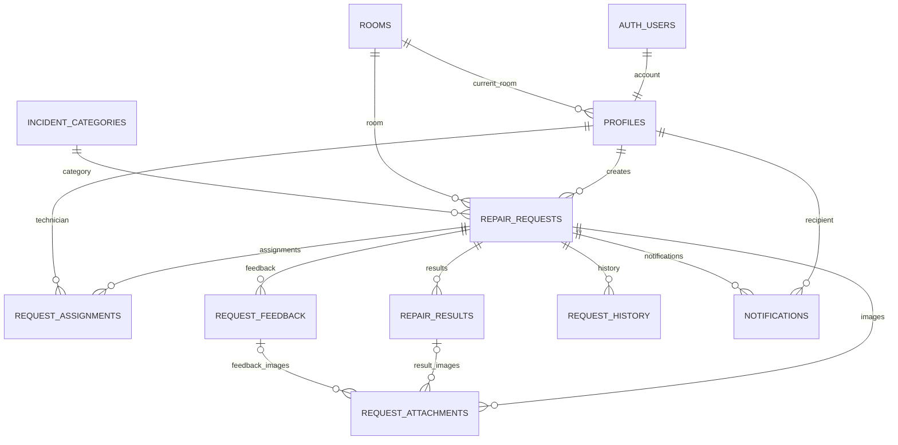

# Thiết kế database DormFix đã chốt

File `001_schema.sql` tạo 10 bảng nghiệp vụ trong một project Supabase mới, enum trạng thái, mã yêu cầu tự tăng, khóa ngoại, index và phân quyền đọc ban đầu. Đây là migration nền tảng, chưa phải backend hoàn chỉnh. Đã chạy thành công trên project DormFix ngày 12/10/2026; kết quả xác minh tại `DEPLOYMENT.md`.

Đọc công việc Kỹ thuật viên DF-020/DF-022 được bổ sung trong `004_technician_jobs.sql`, đã áp dụng ngày 15/10/2026. Hai RPC chỉ cho Kỹ thuật viên active/đã đổi mật khẩu đọc công việc hiện được giao; policy Storage cho phép tải ảnh private theo `can_read_request`. Hợp đồng tại `../docs/technician-jobs-contract.md`, test rollback tại `tests/004_technician_jobs.sql`. Các hàm ghi nghiệp vụ và quyền upload ảnh vẫn chưa có. Không chạy lại các migration đã áp dụng.

DF-028/029/030 thêm RPC đọc danh sách tài khoản Admin trong `009_admin_account_list.sql`. Migration này cần triển khai một lần trên project Supabase; không chạy lại sau khi đã áp dụng. Test phân quyền, tìm kiếm và phân trang rollback tại `tests/009_admin_account_list.sql`.

DF-043/044 thêm các RPC Admin chỉ đọc danh sách, bộ lọc và chi tiết yêu cầu trong `010_admin_request_reads.sql`. Migration chỉ thêm function trên schema hiện có, cần triển khai một lần sau khi được duyệt; không chạy lại sau khi đã áp dụng. Test rollback cho quyền Admin, bộ lọc kết hợp, khoảng ngày và dữ liệu chi tiết nằm ở `tests/010_admin_request_reads.sql`.

## Các quyết định dữ liệu

- Supabase Auth lưu mật khẩu. Một tài khoản Auth liên kết một profile.
- Email đăng nhập cũng là email liên hệ; không được sửa. Mã định danh duy nhất toàn hệ thống, không được đổi hoặc tái sử dụng, kể cả khi thu hồi.
- Sinh viên và Kỹ thuật viên bắt buộc có số điện thoại; người dùng chỉ tự sửa số điện thoại, không sửa email. Backlog đã đồng bộ quy tắc email không được chỉnh sửa.
- Một phòng có nhiều Sinh viên; mỗi Sinh viên thuộc một phòng tại một thời điểm. Sinh viên thu hồi vẫn giữ phòng cũ nhưng không cản ngừng sử dụng phòng; khi khôi phục phải xác nhận/chọn phòng đang hoạt động.
- Yêu cầu lưu ID phòng, mã phòng và tòa nhà tại thời điểm tạo; loại sự cố lưu ID và tên tại thời điểm ghi nhận. Khi sửa loại ở Chờ tiếp nhận, cập nhật tên snapshot theo loại mới, không lưu phiên bản nội dung trước.
- Mã DF000001 tăng dần, có thể có khoảng trống do transaction rollback; mở lại giữ cùng mã.
- Từng lần phân công, kết quả và phản hồi là bản ghi riêng. Cột assigned_technician_id xác định quyền hiện tại; request_assignments giữ lịch sử và cờ xác nhận chuyển giao.
- request_history cũng lưu thao tác quản trị tài khoản/phòng/danh mục qua entity_type và entity_id; các bản ghi này chỉ Admin được đọc.
- Ảnh trong bucket private repair-images, đường dẫn trong request_attachments. 5 ảnh mỗi nhóm: ảnh nội dung hiện tại, mỗi kết quả, mỗi phản hồi; mỗi ảnh tối đa 5 MiB (5,242,880 byte). MIME JPEG/PNG/WebP.

## Quan hệ

## Trạng thái yêu cầu

pending = Chờ tiếp nhận; assigned = Đã phân công; in_progress = Đang xử lý; awaiting_confirmation = Chờ xác nhận; awaiting_rework = Chờ xử lý lại; completed = Hoàn tất; rejected = Từ chối; cancelled = Đã hủy.

Luồng chính: pending → assigned → in_progress → awaiting_confirmation → completed.

- Sửa lại: awaiting_confirmation → awaiting_rework → in_progress.
- Mở lại: completed → pending; chỉ chính chủ, cùng phòng hiện tại, lý do bắt buộc, bỏ phân công hiện tại, giữ lịch sử.
- Hủy: pending/assigned → cancelled; lý do bắt buộc.
- Từ chối: pending → rejected; lý do bắt buộc.
- Đổi người: assigned/in_progress/awaiting_rework giữ trạng thái. Ở in_progress, người mới cần xác nhận tiếp tục trước khi gửi kết quả. Ở awaiting_rework, bấm tiếp tục mới chuyển in_progress.

## Phần bắt buộc làm tiếp trước khi nối ứng dụng

1. Hàm tạo tài khoản và profile bằng quyền server, đồng bộ email Auth/profile, tạo Admin ban đầu. Chặn đổi email tại Auth và profile, đổi mã định danh và tự nâng quyền. Không lưu mật khẩu tạm trong bảng.
2. Endpoint đọc đầy đủ hồ sơ chính chủ và danh sách tài khoản Admin; endpoint cập nhật số điện thoại chính chủ. Bảng profiles chỉ cấp quyền đọc id/full_name/phone để tránh lộ thông tin quản trị và email người khác.
3. Hàm quản trị tài khoản: khóa, thu hồi, khôi phục, đặt lại mật khẩu; kiểm tra Kỹ thuật viên còn công việc chưa hoàn tất trong transaction, chặn phiên cũ, ghi lý do và lịch sử. must_change_password chỉ server được xác nhận sau khi đổi thành công.
4. Hàm tạo/sửa/hủy/phân công/chuyển giao/bắt đầu/tiếp tục/báo kết quả/xác nhận/sửa lại/mở lại: khóa bản ghi yêu cầu, kiểm tra role/status/version, cập nhật lịch sử và thông báo cùng transaction. Kiểm tra tài khoản và danh mục/phòng hiện tại. Không cho ghi trạng thái trực tiếp từ Flutter.
5. Endpoint lịch sử phân công đầy đủ cho Admin/chính chủ/người hiện được giao; người cũ chỉ đọc các cột tóm tắt đã cấp. Cập nhật title_snapshot khi chuyển giao để thông tin tóm tắt không bị cập nhật về sau.
6. Chính sách Storage private theo quyền yêu cầu; kiểm tra giới hạn 5 ảnh mỗi nhóm bằng transaction và metadata thực tế của object. Ảnh/kết quả/phản hồi đã gửi không được sửa; ảnh nội dung hiện tại có thể thay khi pending, không ảnh hưởng ảnh phản hồi cũ.
7. Hàm đọc thông báo/đánh dấu đã đọc, không cho người nhận tự tạo/sửa nội dung thông báo; thao tác mở chi tiết kiểm tra quyền hiện tại.
8. Hàm quản trị phòng và danh mục: chặn ngừng phòng có Sinh viên active/locked; kiểm tra phòng hoạt động khi tạo/khôi phục/chuyển phòng; cập nhật updated_at từ server.

## Kiểm tra trước khi chạy migration

Chỉ chạy trên project mới chưa có các object cùng tên. Migration nằm trong transaction; không xóa bảng hay thay dữ liệu cũ. Sau tạo bảng, chưa có quyền ghi từ client và chưa có Storage policy. Chưa có tài khoản demo. Schema đã được xác minh thực thi; các quy tắc nghiệp vụ và quyền truy cập theo từng role cần kiểm thử tiếp với tài khoản demo.

DF-045/046 thêm các RPC ghi Admin cho phân công và từ chối trong `011_admin_request_workflow.sql`. RPC kiểm tra Admin/trạng thái tại server, khóa dòng, ghi lịch sử trong cùng transaction; không thay đổi RPC Sinh viên/KTV hiện có. Test rollback tại `tests/011_admin_request_workflow.sql`. `rollback/011_disable_admin_request_workflow.sql` thu hồi quyền EXECUTE để vô hiệu hóa API mà không xóa function hay dữ liệu.
